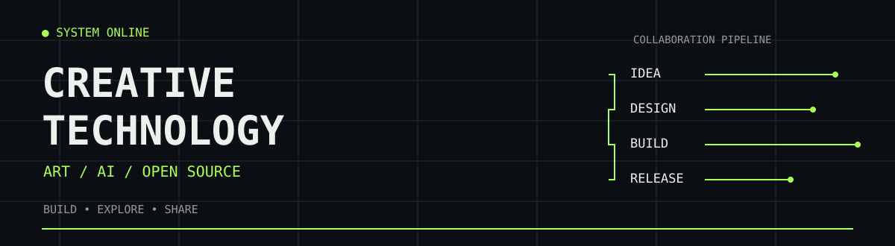

### Built by curiosity. Assisted by AI. Shared with the world.

*An art student exploring the intersection of art, artificial intelligence, and open source.*

---

### `> whoami`

**MRSHDER** · Creative technology explorer

I'm an art student interested in creative technology, AI-assisted workflows, software projects, and open collaboration. I enjoy learning by building and sharing what I discover.

### `> ai-collaborators`

<table>
<tr>
<td align="center" width="50%"></td>
<td align="center" width="50%"></td>
</tr>
</table>

Independent projects using AI tools. Not affiliated with or endorsed by OpenAI or Anthropic.

### `> projects`

### `> principles`

---

